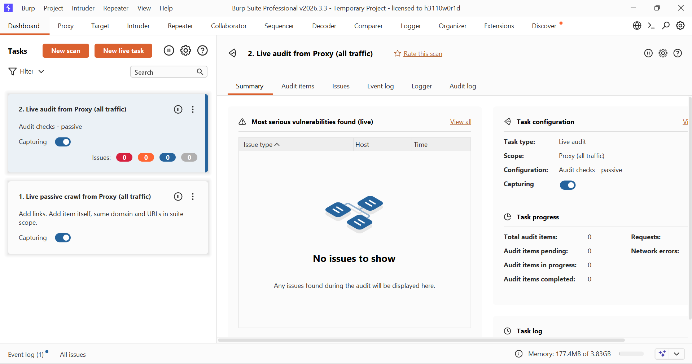

z<p align="center"> 



# <h1 align="center"> Burpsuite Professional v2024 latest </h1>

<p align="center"> Burp Suite Professional is a powerful toolkit for web application security testing, combining automation with advanced manual and semi-automated tools to identify vulnerabilities. From OWASP Top 10 issues to emerging attack techniques, it helps security professionals uncover hidden weaknesses and improve application security.

📌 Credits: Shield Security</p>

<h1 align="center">

[Overview](https://portswigger.net/burp/pro)
 </h1>
 
<br></br>

<h1 align="center"> Linux Installation </h1>

<br></br>

- ### Auto Install
```sh
wget -qO- https://raw.githubusercontent.com/CaptainRogers523/Burpsuite-Professional/main/install.sh | sudo bash
```
- ### Run
```sh
burpsuitepro
```
<details><summary>

### Update [Optional]
</summary>

```sh
cd && rm -rf Burpsuite-Professional && wget -qO- https://raw.githubusercontent.com/CaptainRogers523/Burpsuite-Professional/refs/heads/main/update.sh | sudo sh
```
</details>

<details><summary>

### Java Version [ stable: openjdk-21-jre ]
</summary>

```sh
sudo update-alternatives --config java
```               
</details>

- ### Setup Licenses

<div align="center">
 
https://github.com/CaptainRogers523/Burpsuite-Professional/assets/117867334/c25831a4-68a2-44ee-b6dd-5ff18165f340
</div>
 
Note: Copy the license from loader to the burpsuite > manual activation > copy burpsuite request key to loader request >  copy response key to the burpsuite.

- ### Create a Launcher (xfce)

     right click the desktop -> create a launcher name it Burpsuite Professional, add command `burpsuitepro` and select burpsuite community icon.

<div align="center">
 
</div>

# <h1 align="center"> Windows Installation</h1>

<br>
 
- Make a `Burp` directory name in `C Drive` for faster access.

- Download [install.ps1](https://codeload.github.com/CaptainRogers523/Burpsuite-Professional/zip/refs/heads/main) and extract move the file inside to `C:\Burp`

- Open `Powershell` as administrator and execute below command to set Script Execution Policy.


      Set-ExecutionPolicy -ExecutionPolicy bypass -Scope process

- Inside PowerShell go to `cd C:\Burp`

- Now Execute `install.ps1` file in Powershell to Complete Installation.

      ./install.ps1
 
- Change the icon of `Burp-Suite-Pro.vbs` to the given icon 

- Create a shortcut to Desktop. Right Click over `Burp-Suite-Pro.vbs` Go to Shortcut tab, and below there is `Change Icon` tab

- Click there and choose the `burp-suite.ico` from `C:\Burp\`

   <div align="center">
    
    
</div>

- For Start Menu Entry, copy `Burp-Suite-Pro.vbs` file to 

      C:\ProgramData\Microsoft\Windows\Start Menu\Programs\


<h1 align="center" >


 <details><summary>Credits 👇</summary>


* Repository Creator 👉 [Shield Security](https://github.com/CaptainRogers523/Burpsuite-Professional)
* Loader.jar 👉 [h3110w0r1d-y](https://github.com/h3110w0r1d-y/BurpLoaderKeygen)
* Modified 👉 [cyb3rzest](https://github.com/cyb3rzest/Burp-Suite-Pro)

</details>
</h1>
